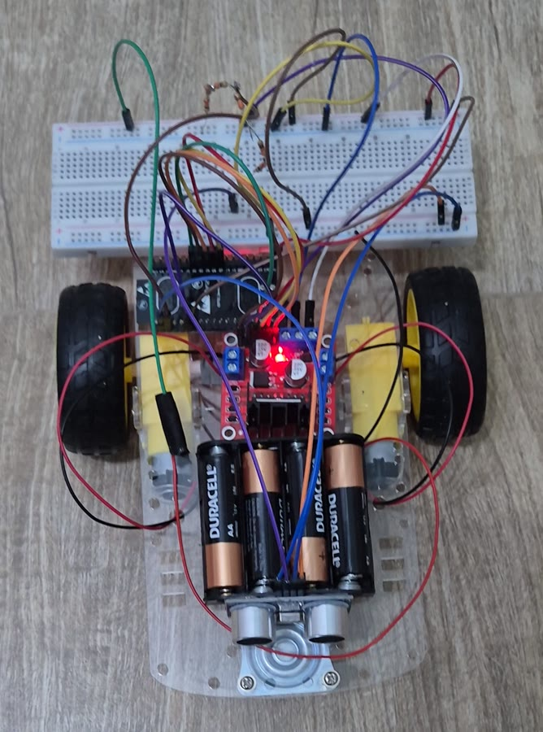
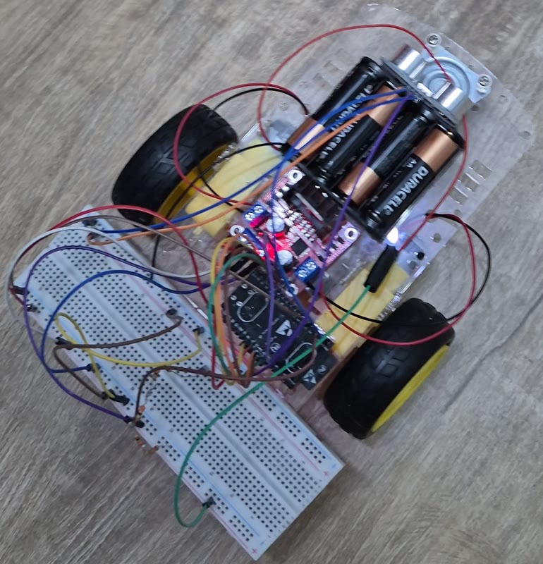

<div align="center">

# 🤖 TinyML Obstacle-Avoiding Robot Car

**Autonomous ESP32 robot car that avoids collisions by combining an ultrasonic sensor with an on-device Edge Impulse TinyML model.**


https://github.com/user-attachments/assets/6eea26b3-4648-4353-8227-3b5edaa3141e

▶️ **[Full demo video (45 s, with audio)](media/video_carrinho.mp4)**

</div>

---

## ✨ Overview

A battery-powered robot car built with an **ESP32**, an **L298N H-bridge**, **two TT DC motors** and an **HC-SR04 ultrasonic sensor**. It drives on its own and avoids frontal collisions. Each movement decision combines the measured distance with a **TinyML classifier** trained in **Edge Impulse** on real readings from the car's own sensor and executed directly on the ESP32.

<div align="center">


</div>

## 🚀 Features

- 🛞 **Locomotion:** forward, reverse and in-place spin (differential drive) with PWM speed control
- 🔋 **Standalone power:** 4×AA for the motors, 5 V logic from a USB power bank — no PC needed
- ⏱️ **Autonomous start:** arms itself 5 s after power-on
- 📏 **Sensor-driven navigation:** slows down between 40 and 20 cm; at 20 cm it stops, backs up and turns right
- 🧠 **TinyML:** classifies `livre` (clear), `aproximando` (approaching) and `bloqueado` (blocked) about once per second (**88.89%** on the held-out test set)
- 📶 **Telemetry & control:** Wi-Fi `GET /state` JSON endpoint and serial commands `S` (stop) / `A` (re-arm)
- 🛡️ **Fail-safe:** invalid readings, inference errors or invalid confidence stop the motors
- 🧪 **Tested pipeline:** real and synthetic datasets, Python tests for dataset and model exports, policy compile tests and a Wokwi simulation

## 🧱 Hardware & Tech

| Area | Details |
| --- | --- |
| Board | ESP32 DevKit |
| Actuation | L298N H-bridge, 2× TT DC gear motors, 2WD chassis |
| Sensing | HC-SR04 ultrasonic sensor |
| ML | Edge Impulse (exported Arduino library, float32) · [public project](https://studio.edgeimpulse.com/public/1140184/live) |
| Firmware | Arduino C++ (motors, ultrasonic, inference, navigation policy, Wi-Fi status) |
| Tooling | Arduino CLI, PowerShell build/simulate scripts, Python dataset tools, Wokwi |

## ⚡ Quick Start

1. Put the AA batteries in the holder and plug the ESP32 into the power bank.
2. Place the car on the floor with the sensor unobstructed; after 5 s it starts driving.
3. Send `S` in the Serial Monitor (115200 baud) to stop and `A` to re-arm.

**Build & flash** (Arduino CLI with the ESP32 core, from the repo root):

```powershell
powershell -ExecutionPolicy Bypass -File cp2/tools/build.ps1 -Mode inference -Model real
arduino-cli upload --fqbn esp32:esp32:esp32 --port COM4 --input-dir build/tinyml-real cp2/firmware/carrinho
```

In the Arduino IDE, install `cp2/model/edge-impulse-arduino-real-v1-float32.zip` as a library, open `cp2/firmware/carrinho/carrinho.ino`, select **ESP32 Dev Module** and upload. For Wi-Fi telemetry, copy `wifi_config.example.h` to `wifi_config.h`, fill in SSID/password, re-flash and open `/state` on the IP printed on the serial port.

## 🗂️ Repository Layout

```text
.
├── docs/                  # project documentation (requirements → evidence)
├── media/                 # demo video, animated preview and photos
├── cp1/                   # MVP: distance-threshold firmware + tests
├── cp2/
│   ├── firmware/carrinho/ # final firmware (sensor, TinyML, navigation, motors, Wi-Fi)
│   ├── firmware/teste_*/  # bench test sketches
│   ├── model/             # Arduino library exported from Edge Impulse
│   ├── data/              # real HC-SR04 captures and collection log
│   ├── docs/              # hardware, assembly, data collection, training, navigation
│   ├── evidence/          # logs, screenshots and test records
│   ├── tests/ · tools/    # automated tests and build/collection scripts
│   └── wokwi/             # simulation and wiring sketch
└── knowledge_base/        # earlier LDR activity (independent from the car)
```

## 📚 Documentation (Portuguese)

| Topic | Document |
| --- | --- |
| Requirements, sketches, MVP, backlog, planning and evolution | [docs/01-requisitos-planejamento.md](docs/01-requisitos-planejamento.md) |
| Chassis, adaptations and body | [docs/02-projeto-mecanico.md](docs/02-projeto-mecanico.md) |
| Components, power, sensor, communication, wiring and photos | [docs/03-hardware-eletronica.md](docs/03-hardware-eletronica.md) |
| Firmware: motors, communication and sensor | [docs/04-software.md](docs/04-software.md) |
| Tests, issues, fixes and results | [docs/05-testes-resultados.md](docs/05-testes-resultados.md) |
| Photos, video, demos and usage | [docs/06-evidencias-uso.md](docs/06-evidencias-uso.md) |
| TinyML model (dataset, training, metrics) | [cp2/docs/entrega.md](cp2/docs/entrega.md) |

<details>
<summary><b>📋 Evaluation map</b></summary>

| Criterion | Where to check |
| --- | --- |
| README and presentation | This file |
| Requirements, planning and evolution | [01](docs/01-requisitos-planejamento.md) · commit history |
| Mechanical design and fabrication | [02](docs/02-projeto-mecanico.md) |
| Hardware and electronics | [03](docs/03-hardware-eletronica.md) · [cp2/docs/hardware.md](cp2/docs/hardware.md) |
| Software | [04](docs/04-software.md) · [cp2/firmware/carrinho/](cp2/firmware/carrinho/) |
| Tests and results | [05](docs/05-testes-resultados.md) · [cp2/evidence/](cp2/evidence/) |
| Final evidence | [06](docs/06-evidencias-uso.md) · [video](media/video_carrinho.mp4) |

</details>

## 🎓 Academic Context

Built for the **Project-based Maker Lab** course in the Software Engineering program at **[FIAP](https://www.fiap.com.br/)**.

| Team member | RM |
| --- | --- |
| João Pedro de Albuquerque Oliveira | 551579 |
| Pedro Augusto Carneiro Barone Bomfim | 99781 |
| Matheus Augusto Santos Rego | 551466 |
