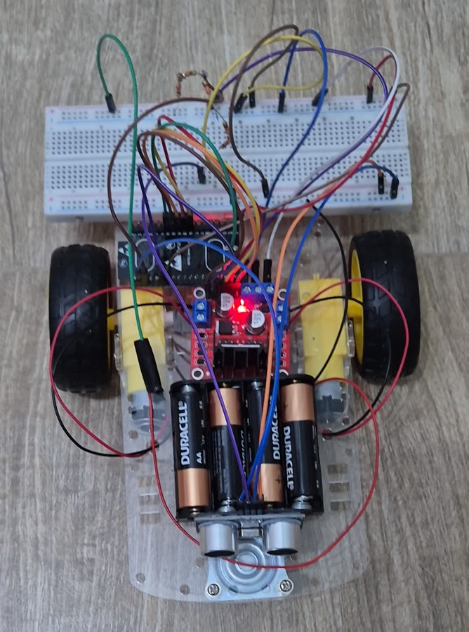

# Carrinho-robô TinyML

<video src="https://github.com/pebarone/carrinho-tinyml/raw/main/media/video_carrinho.mp4" controls muted width="360"></video>

▶️ [Vídeo do carrinho funcionando](media/video_carrinho.mp4) — se o player acima não carregar, abra por este link.

## Integrantes

| Nome | RM |
| --- | --- |
| João Pedro de Albuquerque Oliveira | 551579 |
| Pedro Augusto Carneiro Barone Bomfim | 99781 |
| Matheus Augusto Santos Rego | 551466 |

## Objetivo

Carrinho-robô autônomo com **ESP32**, **ponte H L298N**, **dois motores DC TT**
e **sensor ultrassônico HC-SR04**, alimentado por bateria, que anda sozinho e
evita colisões frontais. A decisão de movimento combina a distância medida
com um modelo **TinyML** (Edge Impulse) treinado com dados reais do próprio
sensor e executado na ESP32.



## Principais funcionalidades

- **Locomoção:** frente, ré e giro no próprio eixo (tração diferencial) com velocidade por PWM.
- **Bateria:** 4 pilhas AA nos motores; lógica em 5 V por powerbank USB. Funciona sem PC.
- **Partida autônoma:** arma sozinho 5 s após ligar.
- **Sensor integrado:** reduz a velocidade entre 40 e 20 cm; a 20 cm para, dá ré e gira à direita.
- **TinyML:** classifica `livre`, `aproximando` e `bloqueado` a cada ~1 s (88,89% no teste reservado).
- **Comunicação:** telemetria Wi-Fi (`GET /state` em JSON) e comandos `S` (parar) / `A` (rearmar) pela serial.
- **Segurança:** leitura inválida, erro de inferência ou confiança inválida param os motores.

## Uso rápido

1. Pilhas no suporte e ESP32 no powerbank.
2. Carrinho no chão com o sensor livre; após 5 s ele começa a andar.
3. `S` no Monitor Serial (115200 baud) para; `A` rearma.

Gravação e detalhes: [instruções de uso](docs/06-evidencias-uso.md#instruções-de-uso).

## Documentação

| Tema | Documento |
| --- | --- |
| Requisitos, esboços, MVP, backlog, planejamento, decisões e evolução | [docs/01-requisitos-planejamento.md](docs/01-requisitos-planejamento.md) |
| Chassi, adaptações e carenagem | [docs/02-projeto-mecanico.md](docs/02-projeto-mecanico.md) |
| Componentes, alimentação, sensor, comunicação, diagrama e fotos | [docs/03-hardware-eletronica.md](docs/03-hardware-eletronica.md) |
| Funcionamento do código: motores, comunicação e sensor | [docs/04-software.md](docs/04-software.md) |
| Testes, problemas, correções e resultado | [docs/05-testes-resultados.md](docs/05-testes-resultados.md) |
| Fotos, vídeo, demonstrações e instruções | [docs/06-evidencias-uso.md](docs/06-evidencias-uso.md) |
| Modelo TinyML (dataset, treino, métricas) | [cp2/docs/entrega.md](cp2/docs/entrega.md) · [Edge Impulse público](https://studio.edgeimpulse.com/public/1140184/live) |

## Organização do repositório

```text
.
├── README.md              ← este arquivo
├── docs/                  ← documentação da entrega (requisitos → evidências)
├── media/
│   ├── video_carrinho.mp4 ← vídeo do carrinho funcionando
│   └── fotos/             ← fotos do carrinho finalizado
├── cp1/                   ← MVP: firmware por limiar de distância + testes
├── cp2/
│   ├── firmware/carrinho/ ← firmware final (sensor, TinyML, navegação, motores, Wi-Fi)
│   ├── firmware/teste_*/  ← sketches de teste de bancada
│   ├── model/             ← biblioteca Arduino exportada do Edge Impulse
│   ├── data/              ← CSVs reais do HC-SR04 e diário de coleta
│   ├── docs/              ← hardware, montagem, coleta, treino e navegação
│   ├── evidence/          ← logs, prints e registros de testes
│   ├── tests/ · tools/    ← testes automatizados e scripts de build/coleta
│   └── wokwi/             ← simulação e esboço de montagem
└── knowledge_base/        ← atividade anterior de LDR (independente do carrinho)
```

## Mapa da avaliação

| Critério | Onde conferir |
| --- | --- |
| README e apresentação | Este arquivo |
| Requisitos, planejamento e evolução | [01](docs/01-requisitos-planejamento.md) · histórico de commits |
| Projeto mecânico e fabricação | [02](docs/02-projeto-mecanico.md) |
| Hardware e eletrônica | [03](docs/03-hardware-eletronica.md) · [cp2/docs/hardware.md](cp2/docs/hardware.md) |
| Software | [04](docs/04-software.md) · [cp2/firmware/carrinho/](cp2/firmware/carrinho/) |
| Testes e resultados | [05](docs/05-testes-resultados.md) · [cp2/evidence/](cp2/evidence/) |
| Evidências finais | [06](docs/06-evidencias-uso.md) · [vídeo](media/video_carrinho.mp4) |
