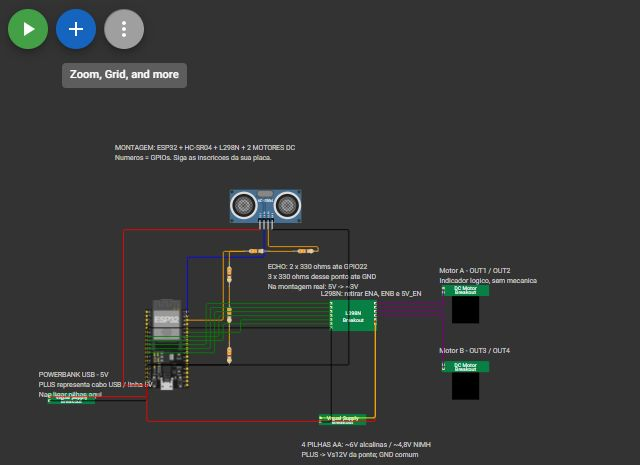

# Requisitos, planejamento e evolução

## Proposta inicial

Construir um carrinho-robô de duas rodas motrizes que se desloque sozinho e
evite colisões frontais usando um sensor de distância. A proposta evoluiu em
duas etapas da disciplina:

1. **CP1:** carrinho funcional com regras fixas de distância (avança, reduz,
   para) — o MVP.
2. **CP2:** a mesma plataforma passa a decidir com um modelo TinyML treinado
   com dados reais do próprio sensor, executado na ESP32.

O esboço inicial das ligações foi feito como diagrama no Wokwi antes da
montagem física. Esses esboços continuam no repositório:

| Esboço / proposta | Arquivo |
| --- | --- |
| Primeiro diagrama ESP32 + HC-SR04 + sinais da ponte H (simulação) | [cp2/wokwi/diagram.json](../cp2/wokwi/diagram.json) · [captura](../cp2/evidence/wokwi/02-free.jpg) |
| Montagem ilustrada com L298N, motores, pilhas e divisor resistivo | [cp2/evidence/assembly/wokwi-montagem.png](../cp2/evidence/assembly/wokwi-montagem.png) · [projeto Wokwi](https://wokwi.com/projects/477883916754720769) |
| Guia visual interativo de montagem | [cp2/docs/montagem.html](../cp2/docs/montagem.html) |

## Requisitos

### Funcionais

| ID | Requisito | Situação |
| --- | --- | --- |
| RF1 | Mover-se para frente e para trás com dois motores DC | Atendido |
| RF2 | Realizar curvas (giro diferencial) | Atendido — giro à direita na manobra de desvio |
| RF3 | Medir a distância à frente com sensor ultrassônico | Atendido — HC-SR04 a 10 Hz |
| RF4 | Reduzir a velocidade ao se aproximar de um obstáculo | Atendido — PWM 220 → 180 entre 40 e 20 cm |
| RF5 | Parar, dar ré e girar ao detectar obstáculo a 20 cm ou menos | Atendido |
| RF6 | Funcionar sem PC, alimentado por bateria | Atendido — partida automática após 5 s |
| RF7 | Permitir parar e rearmar o carrinho por comando | Atendido — `S` / `A` pela serial |
| RF8 | Publicar o estado do carrinho via Wi-Fi | Atendido — endpoint HTTP `/state` (opcional) |
| RF9 | Classificar a situação à frente com TinyML (`livre`, `aproximando`, `bloqueado`) | Atendido no CP2 |

### Não funcionais

- **Segurança:** leitura inválida do sensor, erro de inferência ou confiança
  inválida sempre param os motores; o limite de 20 cm vale independentemente
  do modelo.
- **Proteção elétrica:** ECHO do HC-SR04 (5 V) passa por divisor resistivo
  antes do GPIO da ESP32 (3,3 V).
- **Alimentação separada:** motores nas pilhas (Vs da L298N); lógica em 5 V
  regulados (USB/powerbank), com GND comum.
- **Reprodutibilidade:** código, dados, modelo e comandos de build versionados.

## MVP

O MVP (CP1) é o carrinho que lê o HC-SR04 e aplica três regras fixas:

| Distância | Ação |
| --- | --- |
| > 40 cm | avança |
| 20–40 cm | reduz a velocidade |
| ≤ 20 cm ou leitura inválida | para |

Código: [cp1/firmware/carrinho_threshold](../cp1/firmware/carrinho_threshold/carrinho_threshold.ino) ·
detalhes em [cp1/README.md](../cp1/README.md).

## Backlog

| Item | Prioridade | Status |
| --- | --- | --- |
| Definir componentes e mapa de pinos | Alta | Concluído |
| Firmware de leitura do HC-SR04 | Alta | Concluído |
| Controle dos motores pela L298N com PWM | Alta | Concluído |
| Regras de distância (MVP CP1) | Alta | Concluído |
| Simulação no Wokwi antes da montagem | Média | Concluído |
| Divisor resistivo no ECHO | Alta | Concluído |
| Teste isolado dos motores (frente/ré) | Alta | Concluído |
| Corrigir sentido invertido do motor B | Alta | Concluído (no código) |
| Coleta de dados reais do sensor | Alta | Concluído — 15 sessões |
| Treinar e exportar modelo no Edge Impulse | Alta | Concluído |
| Integrar inferência ao controle dos motores | Alta | Concluído |
| Partida automática sem PC | Alta | Concluído |
| Manobra de desvio: parada, ré e giro | Alta | Concluído |
| Endpoint Wi-Fi de status | Baixa | Concluído (opcional) |
| Alimentação da lógica só por bateria (conversor 5 V) | Média | Pendente |
| Carenagem | Média | Pendente |
| Mais dados reais (outros alvos/ambientes) | Baixa | Pendente |

## Planejamento e cronograma

| Data | Etapa | Registro |
| --- | --- | --- |
| 13/10/2026 | Firmware CP1 por limiar, firmware modular CP2, pipeline de dados, simulação Wokwi | commits `53cb777` a `5be25ff` |
| 14/10/2026 | Primeira gravação na ESP32 física, teste de motores, ligações com resistores de 330 Ω, guia de montagem, coleta real | commits `501dbf1` a `13703aa` · [diário de coleta](../cp2/data/real/diario-coleta.md) |
| 15/10/2026 | Ajuste de PWM e teste de aproximação com ré e giro | [NAVEGACAO_AUTONOMA.md](../cp2/docs/NAVEGACAO_AUTONOMA.md) |
| 18/10/2026 | Modelo float32 e avanço cauteloso | [navigation-float32-v4](../cp2/evidence/navigation-float32-v4/README.md) |
| 21/10/2026 | Dados reais, modelo e controle autônomo publicados; apresentação | commits `4c74f96` a `103fbb8` |
| 28/10/2026 | Vídeo final e documentação de entrega | este documento |

## Decisões de projeto

| Decisão | Motivo |
| --- | --- |
| **ESP32 DevKitC V4** | Wi-Fi integrado, memória e CPU suficientes para rodar o modelo TinyML |
| **L298N** como ponte H | Controla dois motores com sentido e PWM independentes |
| **HC-SR04** | Mede distância frontal de 2 a 400 cm; simples de integrar |
| Divisor com resistores de 330 Ω no ECHO | ESP32 não tolera 5 V; usamos os resistores disponíveis (660 Ω / 990 Ω ≈ 3,0 V) |
| Jumpers ENA/ENB removidos | Permitir controle de velocidade por PWM nos GPIOs 25 e 33 |
| Pilhas só nos motores, lógica em 5 V regulados | Quatro AA não garantem 5 V estáveis no regulador da L298N; sob carga caíram de 5,5 V para 3,8 V |
| Sentido do motor B corrigido no código | Evita refazer a fiação; documentado para ninguém inverter os fios de novo |
| Partida automática após 5 s | O carrinho precisava funcionar desconectado do PC |
| Parada/ré/giro pela distância direta (≤ 20 cm) | Segurança não pode depender da confiança do modelo |
| Modelo float32 em vez de int8 | A versão int8 saturava a entrada acima de ~61,9 cm |
| Avanço cauteloso com baixa confiança | Evitar que o carrinho ficasse parado entre 41 e 54 cm |

## Evolução e alterações

1. **CP1 — limiar fixo:** avança/reduz/para por distância; iniciava desarmado.
2. **CP2 sintético:** firmware modular, dataset sintético e modelo int8 validados no Wokwi.
3. **Montagem física:** gravação na ESP32, teste de motores, divisor resistivo, correção do sentido do motor B.
4. **Dados reais:** 15 sessões do HC-SR04, novo modelo no Edge Impulse (projeto público 1140184).
5. **Navegação autônoma:** partida automática, redução proporcional, manobra de ré e giro.
6. **Float32:** troca do modelo para eliminar saturação; avanço cauteloso.
7. **Entrega CP1:** vídeo final, fotos e documentação completa (este repositório).

Os problemas que motivaram cada alteração estão em
[05-testes-resultados.md](05-testes-resultados.md).
