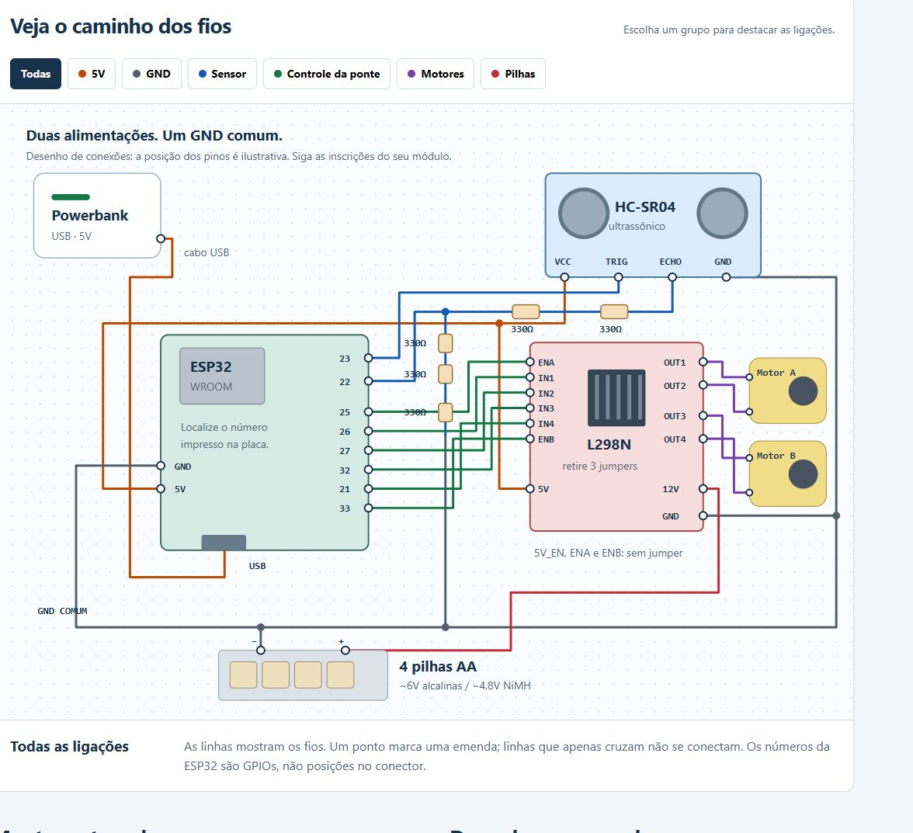

# Hardware e eletrônica

## Lista de componentes

| Qtd. | Componente | Função |
| ---: | --- | --- |
| 1 | ESP32 DevKitC V4 (ESP32-WROOM, chip ESP32-D0WD-V3) | Microcontrolador, Wi-Fi e inferência TinyML |
| 1 | Ponte H L298N | Sentido e velocidade (PWM) dos dois motores |
| 2 | Motorredutor DC TT 3–6 V com roda | Tração diferencial |
| 1 | Sensor ultrassônico HC-SR04 | Distância frontal (2–400 cm) |
| 1 | Suporte para 4 pilhas AA + 4 pilhas | Alimentação dos motores (Vs da L298N) |
| 1 | Fonte 5 V USB (powerbank ou PC) | Alimentação da ESP32, do sensor e da lógica da L298N |
| 5 | Resistor 330 Ω | Divisor de tensão do ECHO (5 V → ~3,0 V) |
| 1 | Protoboard | GND comum, linha de 5 V e divisor |
| — | Jumpers macho-macho/macho-fêmea | Ligações |
| 1 | Chassi em acrílico com roda boba | Estrutura |

## Microcontrolador

**ESP32 DevKitC V4**: dual-core 240 MHz, 520 KB de SRAM, Wi-Fi 2.4 GHz e
Bluetooth. Gera os pulsos do HC-SR04, executa o classificador Edge Impulse
(~1 s de janela) e controla a L298N com PWM de 1 kHz / 8 bits.

## Motores e ponte H

- Motor A em **OUT1/OUT2**, controlado por ENA (PWM), IN1 e IN2.
- Motor B em **OUT3/OUT4**, controlado por ENB (PWM), IN3 e IN4.
- Jumpers **ENA e ENB removidos** para que a ESP32 controle a velocidade.
- Curvas: um motor para frente e o outro para trás (giro no próprio eixo).
- O sentido do motor B é compensado no código; não inverter os fios.

## Alimentação

| Linha | Fonte | Alimenta |
| --- | --- | --- |
| Vs / 12V da L298N | 4 pilhas AA (~6 V alcalinas) | Somente os motores |
| 5 V | USB da ESP32 (powerbank) → pino 5V | ESP32, VCC do HC-SR04, lógica 5V da L298N (jumper 5V_EN removido) |
| GND | Comum | ESP32, sensor, L298N, pilhas |

O positivo das pilhas **nunca** é ligado ao 5V da ESP32. Detalhes, cuidados
e datasheets: [cp2/docs/hardware.md](../cp2/docs/hardware.md).

## Sensor

**HC-SR04** na frente do carrinho, amostrado a 10 Hz (a cada 100 ms).
TRIG direto no GPIO 23. O ECHO sai em 5 V, então passa por um divisor:

```text
ECHO ── 330Ω ── 330Ω ──┬── GPIO22
                       │
                     330Ω
                       │
                     330Ω
                       │
                     330Ω
                       │
                      GND        (660 Ω / 990 Ω → ~3,0 V)
```

## Tecnologia de comunicação

| Canal | Uso |
| --- | --- |
| **Wi-Fi (ESP32, modo estação)** | Telemetria opcional: com `wifi_config.h` preenchido, a ESP32 entra na rede e serve `GET /state` em JSON (distância, classe, confiança, ação, armado). Roda em tarefa separada para não atrasar sensor/motores. |
| Serial USB 115200 baud | Comandos `S` (parar/desarmar) e `A` (rearmar) e log das leituras/inferências |

## Diagrama de conexões

| Sinal | ESP32 |
| --- | --- |
| HC-SR04 TRIG | GPIO 23 |
| HC-SR04 ECHO (após divisor) | GPIO 22 |
| L298N ENA (PWM motor A) | GPIO 25 |
| L298N IN1 / IN2 | GPIO 26 / GPIO 27 |
| L298N ENB (PWM motor B) | GPIO 33 |
| L298N IN3 / IN4 | GPIO 32 / GPIO 21 |



- Guia interativo (abrir no navegador): [cp2/docs/montagem.html](../cp2/docs/montagem.html)
- Passo a passo com a placa física: [cp2/docs/LIGACAO_PLACA_FISICA.md](../cp2/docs/LIGACAO_PLACA_FISICA.md)
- Projeto Wokwi da montagem: <https://wokwi.com/projects/477883916754720769>

## Fotos da montagem

| Vista superior | Vista diagonal |
| --- | --- |
|  |  |
