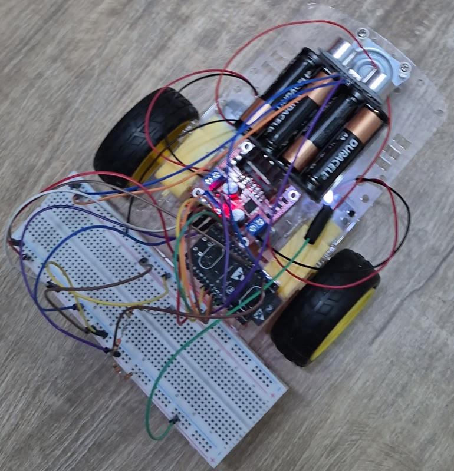
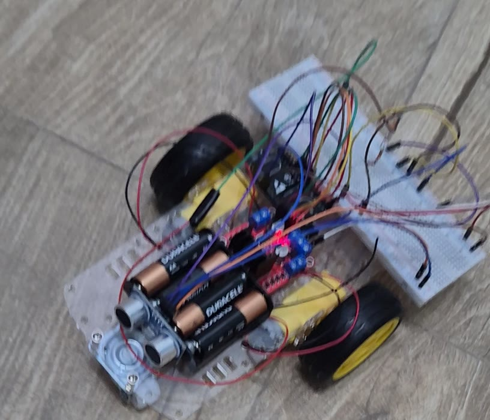
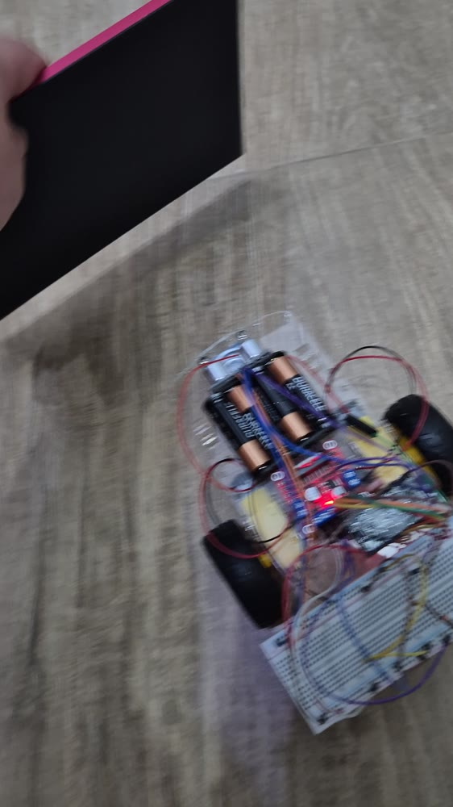

# Evidências finais e instruções de uso

## Vídeo

[media/video_carrinho.mp4](../media/video_carrinho.mp4) — 45 s: o carrinho
se desloca sozinho pelo piso; quando um obstáculo é colocado à frente do
HC-SR04, ele recua e muda de direção (demonstração do sensor).

## Fotos do carrinho finalizado

| Vista superior | Vista diagonal |
| --- | --- |
|  |  |

| Em movimento | Obstáculo à frente do sensor |
| --- | --- |
|  |  |

As fotos são quadros do vídeo final.

## Demonstração do sensor

- Vídeo: obstáculo colocado à frente → recuo e mudança de direção.
- Registro serial da aproximação (PWM caindo de 202 para 180 e manobra a
  19,7 cm): [navigation-distance-v3.json](../cp2/evidence/real-training-v1/navigation-distance-v3.json).

## Demonstração da comunicação

- Comandos `S`/`A` e log em tempo real pelo Monitor Serial (115200 baud).
- Telemetria Wi-Fi em `http://<ip-do-carrinho>/state` quando
  `wifi_config.h` está configurado ([como funciona](04-software.md#comunicação-sem-fio)).

## Instruções de uso

1. **Montagem:** confira as ligações em [03-hardware-eletronica.md](03-hardware-eletronica.md).
   Jumpers ENA, ENB e 5V_EN da L298N removidos.
2. **Gravação:** siga [04-software.md](04-software.md#compilar-e-gravar).
3. **Alimentação:** coloque 4 pilhas AA no suporte (motores) e conecte a
   ESP32 a um powerbank pelo USB (lógica e sensor).
4. **Partida:** coloque o carrinho no chão, com a frente (sensor) livre. Após
   **5 segundos** ele arma sozinho e começa a andar.
5. **Durante o uso:** ele reduz entre 40 e 20 cm do obstáculo; a 20 cm para,
   dá ré e gira à direita.
6. **Parar:** envie `S` pelo Monitor Serial (115200 baud) ou desligue a
   alimentação. `A` rearma; RESET reinicia a contagem de 5 s.
7. **Telemetria (opcional):** copie `wifi_config.example.h` para
   `wifi_config.h`, preencha SSID/senha, regrave e acesse `/state` no IP
   mostrado na serial.

### Cuidados

- Nunca ligue o positivo das pilhas ao 5V/VIN da ESP32.
- Nos primeiros testes, deixe as rodas suspensas.
- Se o carrinho não sair do lugar, troque as pilhas: com pilhas fracas
  (medimos 3,8 V sob carga) os motores perdem força.
